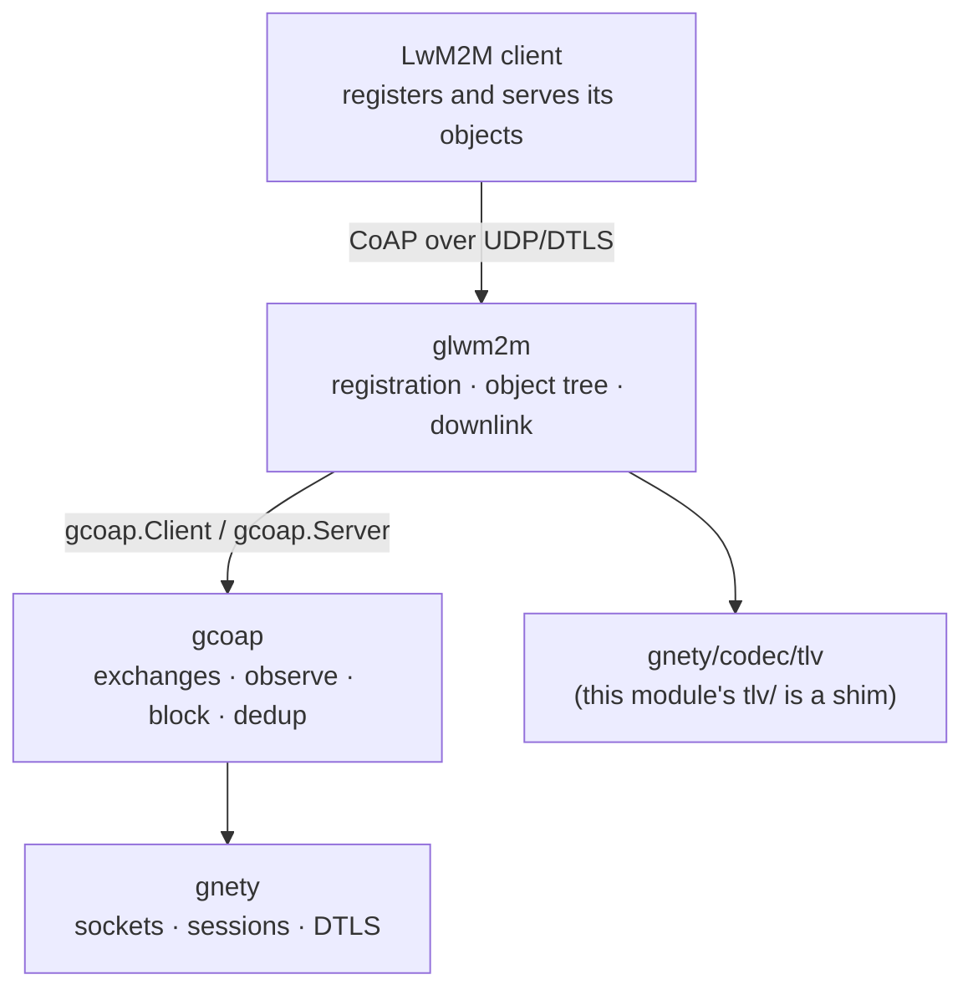
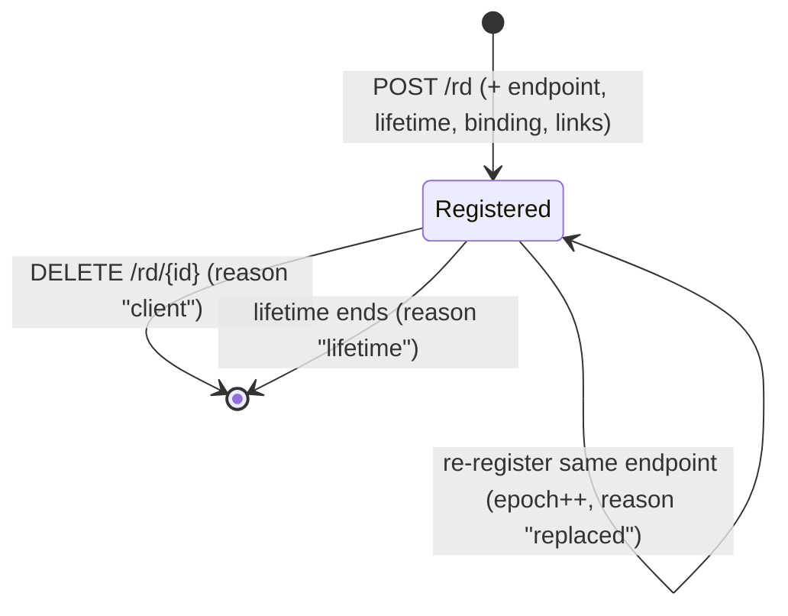

English | [简体中文](ARCHITECTURE.zh-CN.md)

# Architecture: a LwM2M server engine on gcoap

> Applies to the current tree (2026-11-04). The platform repository's
> `docs/design/libs.md` and `docs/design/dependency-rules.md` hold the layering
> rules; this document is the package-level map for this repository.

glwm2m owns the **LwM2M semantics**: the registration lifecycle, the local object
tree and its TLV encoding, server-initiated device management (Read, Write,
Execute, Observe) and the neutral peer identity. Everything below that — CoAP
exchanges, retransmission, deduplication, observe and block-wise transfer — belongs
to gcoap, and the datagram, DTLS and wire formats belong to gnety. Nothing in this
module knows a device, product or tenant identity.

## Where the code lives

| File | Responsibility |
|---|---|
| `server.go` | `Config`, server lifecycle (`New`/`Start`/`Stop`/`Addr`), the `/objects` endpoints (Read/Write/Execute), the object store, write validation and notify-on-write |
| `registration.go` | `Registration`, `PeerInfo`, `EventSink` and the registration lifecycle: `/rd` register, update, delete, the expiry sweep |
| `management.go` | The downlink: `Read`/`Write`/`Execute`/`Observe`, the per-registration client cache, `OperationError` |
| `object.go` | `ObjectDef`/`ResourceDef`/`ObjectRegistry`, value validation, the object store and the TLV entries it builds |
| `binarydata.go` | Object 19 (Binary App Data Container) helpers on top of the downlink |
| `tlv/` | A compatibility shim over `gnety/codec/tlv`; it carries no wire knowledge |
| `version.go` | The version string |

There is one package: the registration table, the object store and the downlink
share the server's lifecycle, and splitting them would only add indirection.

## Registration lifecycle

- **Register.** `POST /rd?ep=…&lt=…&b=…&lwm2m=…` with an optional link-format body
  (`</1/0>,</3303/0>`) answers `2.01 Created` with `Location-Path: rd/{id}`. The
  endpoint name is validated, the lifetime defaults to `DefaultLifetime` and is
  clamped to `MaxLifetime`, an unparsable lifetime or binding is `4.00`, and
  `MaxRegistrations` answers `5.03` beyond the cap.
- **Endpoint conflict.** A second registration for a live endpoint replaces the
  first by default: the new registration gets `Epoch+1`, the old one is removed
  with the event reason `replaced`, and the old downlink client is closed so an
  operation cannot land on the replaced client. `RejectEndpointConflict` answers
  `4.09 Conflict` instead.
- **Update.** `POST /rd/{id}` refreshes `LastSeen`, lifetime, binding, version and
  object links. It is bound to the peer that registered: another peer gets `4.04`,
  while the same endpoint from a moved peer rebinds and drops its cached downlink.
- **Deregister.** `DELETE /rd/{id}` is peer-bound as well and answers `2.02 Deleted`.
- **Expiry.** `ExpiresAt` is `LastSeen + lifetime`; a sweep every `ExpiryInterval`
  removes what has passed and emits `expired` with reason `lifetime`. A negative
  `ExpiryInterval` disables the sweep, which is what tests and embedders use.
- **Events.** `EventSink` receives `registered`, `updated`, `deregistered` and
  `expired`, always outside the registration lock, on the request goroutine or the
  sweeper goroutine — so the sink must not block, and a panic is recovered and
  discarded rather than breaking the server.

## Object tree and the local `/objects` endpoints

One in-memory store maps `(object, instance, resource)` to the values of that
resource — one entry for a single resource, several instances for a multiple
resource.

| Endpoint | Body | Answer |
|---|---|---|
| `GET /objects/{oid}` | — | TLV object: every instance and resource |
| `GET /objects/{oid}/{iid}` | — | TLV instance |
| `GET /objects/{oid}/{iid}/{rid}` | — | `2.05` text/plain for one value, TLV when the resource is multiple |
| `PUT /objects/{oid}` or `…/{iid}` | TLV | `2.01`/`2.04`; the whole body is validated before one atomic apply |
| `PUT /objects/{oid}/{iid}/{rid}` | value | `2.04 Changed` |
| `POST /objects/{oid}/{iid}/{rid}` | arguments | `2.04 Changed` (Execute) |

With `Config.Objects` set, `ObjectRegistry` decides what may be read, written and
executed: an unknown object or resource is `4.04`, a non-writable write or a
non-executable execute `4.05`, an invalid value `4.00`, and a multiple resource
written as a single value (or the reverse) is rejected. A write notifies the
observers of the affected resources.

## Downlink: server-initiated management

`Server.Read`, `Write`, `Execute` and `Observe` send real CoAP requests to the
address a registration arrived from (UDP), or through `Config.DownlinkTLS` for a
DTLS callback; `Config.DownlinkDialer` replaces the dialer entirely for a transport
or address the registration socket does not describe. One client is cached per
registration and tagged with its epoch, so an operation never reaches a replaced
client. Every call is bounded by `DownlinkTimeout`; an error response is a typed
`*OperationError`, not a transport failure.

`Observe` returns the value the registration answered with and hands later values
to the callback on the downlink client's receive goroutine — it must not block. The
observation ends with `Cancel`, with `Client.Close`, or when the registration's
cached client is closed by deregistration, expiry or `Server.Stop`.

Downlink paths use the same `/objects/{oid}[/{iid}[/{rid}]]` form as the local
endpoints. A stock LwM2M client serves `/{oid}/{iid}/{rid}` instead; the
interoperability item in `ROADMAP.md` is what will settle that against a reference
implementation (Leshan).

## Concurrency

- The registration table is guarded by `Server.mu`; the object store has its own
  mutex so a multi-resource write is atomic; downlink state has its own mutex.
- The expiry sweep is one goroutine, started by `Start` and stopped by `Stop`.
- `EventSink` callbacks and downlink `Observe` handlers run outside the locks but
  on library goroutines: they must not block and must not call back into the server.
- `Stop` stops the sweep, closes every cached downlink (which ends its
  observations) and stops the CoAP listener.

## Limits and defaults

| Field | Default | Meaning |
|---|---|---|
| `DefaultLifetime` | 24h | lifetime when a registration carries no `lt` |
| `MaxLifetime` | 7 days | cap a client may request; a larger value is clamped |
| `ExpiryInterval` | 1s | expiry scan interval; negative disables it |
| `MaxRegistrations` | 1024 | live registrations; beyond it a registration is `5.03` |
| `DownlinkTimeout` | 10s | bound of one server-initiated operation |
| `DownlinkMaxRequestSize` | 1 MiB | one downlink body, Block1 included (gcoap's default) |

The CoAP-level limits — observers, block size, deduplication, exchange timings —
come from gcoap's defaults; `glwm2m.Config` does not expose them today.

## How this is verified

| Level | Where | What it proves |
|---|---|---|
| Unit | `*_test.go` | registration lifecycle (conflict, expiry, peer binding, events), object validation and atomic writes, downlink Read/Write/Execute/Observe, Object 19 — against a simulated device built from gcoap's client and server |
| Fuzz | `fuzz_test.go` | `FuzzDecodeTLV`: the TLV codec plus the write path (no panic, canonical re-encode, no value larger than the input, the store cannot grow faster than the body); `FuzzDecodeRegistration`: every registration input ends in a defined answer, an accepted one keeps the endpoint and stays inside the lifetime cap, a rejected one leaves no state |
| Examples | `examples/` | the advertised API compiles and runs; `-serve` turns either example into a server an external LwM2M client can register with |
| CI | `.github/workflows/ci.yml` | `test` on three OSes, `race` and a short run of both fuzz targets |

## Known gaps

- **Interoperability with a reference implementation** (Leshan, a vendor simulator or
  a real device) is still a `ROADMAP.md` item; the downlink path form above is the
  first thing it will exercise.
- **No bootstrap interface.** A device must be provisioned with the server URI.
- **Certificate-only DTLS.** gnety's transport has no pre-shared-key mode; see
  `DEPLOYMENT.md`.
- **In-memory registrations.** A restart drops them; there is no pluggable store
  yet (ROADMAP).
- **No per-peer downlink quota**, and no metrics hooks of its own: the registration
  events are the observable surface, and gcoap's `Metrics` is not exposed through
  `glwm2m.Config`.
