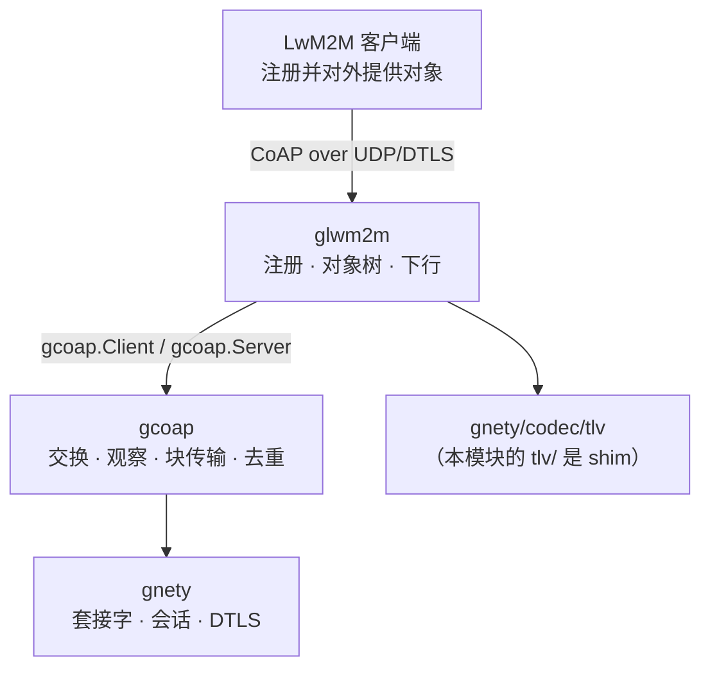
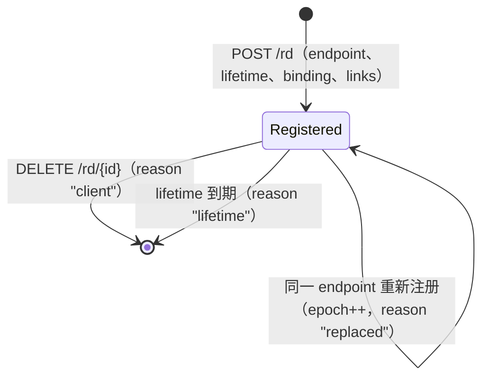

[English](ARCHITECTURE.md) | 简体中文

# 架构：跑在 gcoap 之上的 LwM2M 服务端引擎

> 适用于当前代码树（2026-11-04）。分层规则本身写在平台仓库的
> `docs/design/libs.md` 与 `docs/design/dependency-rules.md`；这份文档是本仓库的包级地图。

glwm2m 负责**LwM2M 语义**：注册生命周期、本地对象树及其 TLV 编码、服务端发起的设备管理
（Read、Write、Execute、Observe），以及中性的对端身份。再往下 —— CoAP 交换、重传、去重、
观察与块传输 —— 属于 gcoap；数据报、DTLS 与线格式属于 gnety。这个模块里没有任何设备、产品
或租户身份。

## 代码在哪里

| 文件 | 职责 |
|---|---|
| `server.go` | `Config`、服务端生命周期（`New`/`Start`/`Stop`/`Addr`）、`/objects` 端点（Read/Write/Execute）、对象存储、写入校验与写入后通知 |
| `registration.go` | `Registration`、`PeerInfo`、`EventSink` 与注册生命周期：`/rd` 的 register、update、delete 与过期扫描 |
| `management.go` | 下行：`Read`/`Write`/`Execute`/`Observe`、按注册缓存的客户端、`OperationError` |
| `object.go` | `ObjectDef`/`ResourceDef`/`ObjectRegistry`、值校验、对象存储与它构造的 TLV 条目 |
| `binarydata.go` | Object 19（Binary App Data Container）在下行之上的辅助函数 |
| `tlv/` | 对 `gnety/codec/tlv` 的兼容 shim，自身不含任何线格式知识 |
| `version.go` | 版本字符串 |

只有一个包：注册表、对象存储与下行共享同一个服务端生命周期，拆开只会多一层间接。

## 注册生命周期

- **注册。** `POST /rd?ep=…&lt=…&b=…&lwm2m=…`，请求体可选，为 link-format 的
  `</1/0>,</3303/0>`；应答 `2.01 Created` 且带 `Location-Path: rd/{id}`。endpoint 名会校验，
  lifetime 缺省取 `DefaultLifetime` 并被 `MaxLifetime` 截断，无法解析的 lifetime 或 binding 回
  `4.00`，超过 `MaxRegistrations` 回 `5.03`。
- **endpoint 冲突。** 同一 endpoint 再次注册默认替换旧的：新注册 `Epoch+1`，旧注册被移除并带
  事件 reason `replaced`，旧的下行客户端被关闭，避免操作落到被替换的客户端上。
  置 `RejectEndpointConflict` 时改为回 `4.09 Conflict`。
- **更新。** `POST /rd/{id}` 刷新 `LastSeen`、lifetime、binding、version 与对象清单。它与注册
  时的对端绑定：别的对端回 `4.04`；同一 endpoint 从搬移过的对端来时重绑地址并丢掉缓存的下行。
- **注销。** `DELETE /rd/{id}` 同样绑定对端，回 `2.02 Deleted`。
- **过期。** `ExpiresAt = LastSeen + lifetime`；每 `ExpiryInterval` 扫描一次，清掉已过期者并发
  `expired`、reason `lifetime`。`ExpiryInterval` 为负时关闭扫描，测试与嵌入方依赖这一点。
- **事件。** `EventSink` 收到 `registered`、`updated`、`deregistered` 与 `expired`，始终在注册锁
  之外、在请求 goroutine 或扫描 goroutine 上调用 —— 所以 sink 不能阻塞，panic 会被捕获丢弃，
  不会把服务端带崩。

## 对象树与本地 `/objects` 端点

一个内存存储把 `(object, instance, resource)` 映射到该资源的值：单资源一条，多资源多条
（resource instance）。

| 端点 | 请求体 | 应答 |
|---|---|---|
| `GET /objects/{oid}` | — | TLV 对象：所有实例与资源 |
| `GET /objects/{oid}/{iid}` | — | TLV 实例 |
| `GET /objects/{oid}/{iid}/{rid}` | — | 单个值回 `2.05` text/plain；多资源回 TLV |
| `PUT /objects/{oid}` 或 `…/{iid}` | TLV | `2.01`/`2.04`；整个体先完整校验再一次性原子应用 |
| `PUT /objects/{oid}/{iid}/{rid}` | 值 | `2.04 Changed` |
| `POST /objects/{oid}/{iid}/{rid}` | 参数 | `2.04 Changed`（Execute） |

配置了 `Config.Objects` 时由 `ObjectRegistry` 决定什么能读、能写、能执行：未知对象或资源
`4.04`，不可写/不可执行 `4.05`，非法值 `4.00`，把多资源写成单值（或反过来）也会被拒。写入会
通知被改资源的观察者。

## 下行：服务端发起的设备管理

`Server.Read`、`Write`、`Execute`、`Observe` 会向注册来源地址发真实的 CoAP 请求（UDP），
DTLS 回拨走 `Config.DownlinkTLS`；`Config.DownlinkDialer` 可以替换整个拨号器，用于注册来源
socket 描述不了的传输或地址。每个注册缓存一个客户端并带 epoch 标记，操作不会落到被替换的
客户端上。每次调用都受 `DownlinkTimeout` 约束；错误响应是带类型的 `*OperationError`，不是传输
失败。

`Observe` 返回注册时设备答复的值，后续值交给回调 —— 回调跑在下行客户端的接收 goroutine 上，
不能阻塞。观察随 `Cancel`、`Client.Close`，或注册缓存客户端被注销/过期/`Server.Stop` 关闭而
结束。

下行使用 LwM2M 客户端服务的路径：`/{oid}[/{iid}[/{rid}]]`。库自己的 `/objects/...` 端点只
是服务端一侧的接口，不会出现在发给设备的线路上。

## 并发

- 注册表由 `Server.mu` 保护；对象存储有自己的锁，使多资源写入原子；下行状态也有自己的锁。
- 过期扫描是一个 goroutine，由 `Start` 启动、`Stop` 停止。
- `EventSink` 回调与下行 `Observe` 回调在锁之外、但在库的 goroutine 上运行：不能阻塞，也不能
  回调进服务端。
- `Stop` 先停扫描，再关闭每个缓存的下行（连带结束其观察），最后停 CoAP 监听器。

## 限额与默认值

| 配置项 | 默认 | 含义 |
|---|---|---|
| `DefaultLifetime` | 24h | 注册未带 `lt` 时的 lifetime |
| `MaxLifetime` | 7 天 | 客户端可请求的上限；超出会被截断 |
| `ExpiryInterval` | 1s | 过期扫描间隔；为负则关闭 |
| `MaxRegistrations` | 1024 | 活跃注册上限，超出注册回 `5.03` |
| `DownlinkTimeout` | 10s | 单次服务端发起操作的时限 |
| `DownlinkMaxRequestSize` | 1 MiB | 单次下行体的上限（含 Block1），取 gcoap 默认 |

CoAP 层的限额 —— 观察者、块大小、去重、交换时序 —— 都来自 gcoap 的默认值；
`glwm2m.Config` 目前没有暴露它们。

## 怎么验证

| 层次 | 位置 | 证明了什么 |
|---|---|---|
| 单元 | `*_test.go` | 注册生命周期（冲突、过期、对端绑定、事件）、对象校验与原子写、下行 Read/Write/Execute/Observe、Object 19 —— 对手是用 gcoap 客户端与服务端搭出来的模拟设备 |
| Fuzz | `fuzz_test.go` | `FuzzDecodeTLV`：TLV 编解码加写入路径（不 panic、重编码规范、值不超过输入规模、存储增长速度不超过请求体）；`FuzzDecodeRegistration`：任意注册输入都有确定答复，接受的注册保留 endpoint 且不超过 lifetime 上限，拒绝的不留状态 |
| 示例 | `examples/` | 文档给出的 API 能编译能跑；`-serve` 把任一示例变成外部 LwM2M 客户端可注册的服务端 |
| CI | `.github/workflows/ci.yml` | 三个 OS 的 `test`、`race`，以及两个 fuzz 目标的短时运行 |

## 已知差距

- **目前互操作覆盖注册、Read 与 Observe**：Eclipse Leshan 客户端能注册、能被服务端 Read，
  也能在它自己的会话上接受 Observe；真机与反方向仍开放（`ROADMAP.md`）。
- **没有 bootstrap 接口。** 设备必须被预置服务端 URI。
- **只支持证书 DTLS。** gnety 的传输没有预共享密钥模式，见 `DEPLOYMENT.md`。
- **注册只在内存里。** 重启即丢，还没有可插拔存储（ROADMAP）。
- **没有 per-peer 下行配额**，也没有自己的指标钩子：注册事件是唯一可观测面，gcoap 的
  `Metrics` 没有通过 `glwm2m.Config` 暴露出来。
